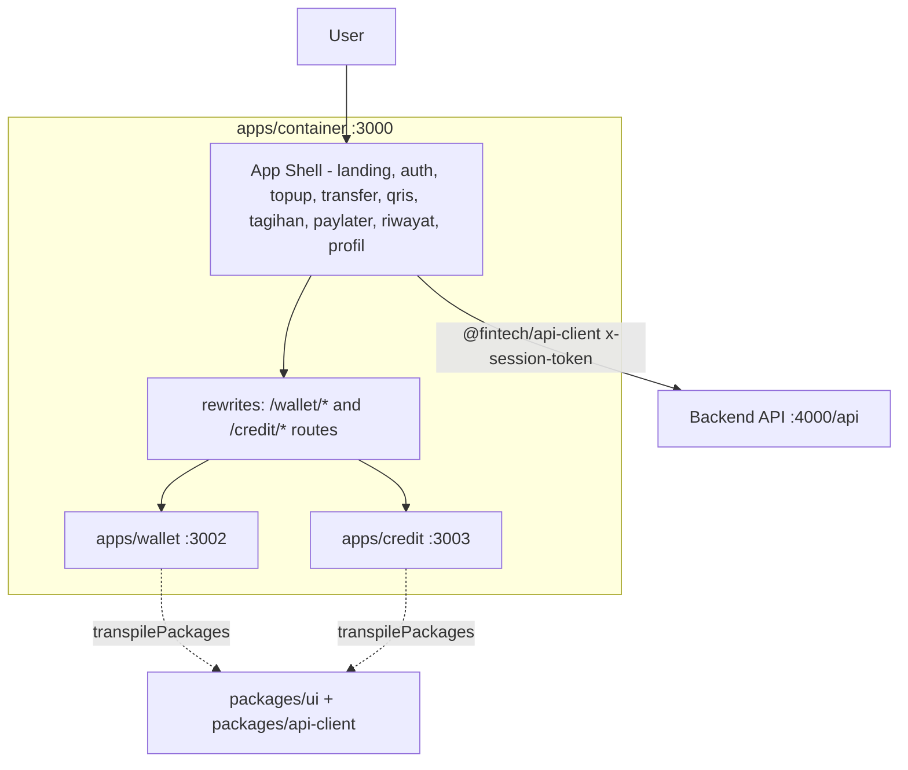

# QUPI Apps — QUick Payment Instrument · Fintech Pilot Frontend (Next.js Multi-Zone)
[](https://github.com/adul11s/qupi-apps/actions/workflows/ci.yml)

The **QUPI** frontend pilot (a portfolio project, not a go-live product):
a Next.js App Router application using a **multi-zone micro-frontend**
pattern — one container shell that composes child zones via `rewrites()`,
with no runtime federation.

> ⚠️ **Sandbox / simulated data.** All data in this application is demo data
> produced by a backend stub (a mock service provider), not a real financial
> service. A permanent "Sandbox / simulated data" banner is shown on the
> home page.

## Zone structure (what actually exists in this repo)

| App              | Dev port | Route in shell  | Contents                                                    |
|------------------|----------|-----------------|-------------------------------------------------------------|
| `apps/container` | **3000** | `/`             | App shell, navigation, and all core QUPI pages: auth (`app/auth`), top-up, transfer, QRIS, bills, paylater, history, profile |
| `apps/wallet`    | **3002** | `/wallet/*`     | Wallet child zone (composed via rewrites)                    |
| `apps/credit`    | **3003** | `/credit/*`     | Credit child zone (composed via rewrites)                    |
| `apps/auth`      | 3001     | —               | **Unused** in the demo flow (local auth lives in the container); it remains as an app and is not rewritten |

The backend API runs separately (see the backend repository) at
`http://localhost:4000`, with `NEXT_PUBLIC_API_URL=http://localhost:4000/api`
as the default.

### Zoning diagram



Alternative text version (ASCII):

```
            Browser (:3000)
                 │
    ┌────────────▼─────────────┐
    │  apps/container   :3000  │─ auth, top-up, transfer,
    │  shell + core pages      │  QRIS, bills, paylater,
    │                          │  history, profile
    │  rewrites():             │
    │    /wallet/*  → :3002    │────────► apps/wallet :3002
    │    /credit/*  → :3003    │────────► apps/credit :3003
    └───────┬──────────────────┘
            │ fetch (NEXT_PUBLIC_API_URL, default :4000/api)
            ▼
       Backend API :4000  (separate backend repo, NestJS)
```

## The `packages/api-client` contract

- `@fintech/api-client` is the single path for all HTTP access to the backend.
- `API_BASE_URL` comes from `NEXT_PUBLIC_API_URL` (default
  `http://localhost:4000/api`); NestJS uses a global `/api` prefix.
- Response format: an envelope `{ message?, data?, ... }`; the client unwraps
  it with type-safe API types, and errors are read from `e?.message`.
- Session authentication: the `x-session-token` header; a `401` response
  triggers `onUnauthorized` (SessionProvider), which redirects the user to
  `/auth`.
- Mutation operations send `idempotencyKey` in the body, per the backend
  contract.
- Shared UI lives in `@fintech/ui` (`Card`, `formatIdr`, etc.) — loaded in
  all zones via `transpilePackages`.

## Running from a fresh clone

```bash
# Backend (a separate repo, NestJS) — start it first; the FE fetches :4000/api
npm install && npm run start:dev   # http://localhost:4000/api

# Frontend (this repo)
npm install
npm run dev          # container at http://localhost:3000
npm run dev:wallet   # http://localhost:3002 (also served at /wallet/* on :3000)
npm run dev:credit   # http://localhost:3003 (also served at /credit/* on :3000)
```

Demo user seeding is done from the backend repository (`npm run seed`),
not from the frontend repo. Without the backend running, pages and
transactions show skeletons or error messages — the app itself stays up.

### Port mapping at a glance

| Service            | Port |
|--------------------|------|
| Backend API        | 4000 |
| Container (shell)  | 3000 |
| Wallet zone        | 3002 |
| Credit zone        | 3003 |
| Auth app (idle)    | 3001 |

## Build & CI

- Build all zones (auth/wallet/credit/container): `npm run build`.
- CI: `.github/workflows/ci.yml` — Node 22, `npm ci`, `tsc --noEmit` per
  workspace, `eslint` for the apps that are in use, then `npm run build`.

## Test status

- **There is no automated test suite in this frontend.** The quality gates on
  the FE side are `tsc --noEmit` (TypeScript strict, 0 errors across all
  workspaces) and eslint (0 errors). Behavioral validation for money flows
  lives in the backend repository (double-entry ledger, idempotency,
  limits), along with its tests.
- The 5-minute manual check per page is documented in
  `docs/demo-script-fe.md`, with screenshots in `docs/screenshots/`.

## Frontend technical decisions & trade-offs

- **Container + rewrites, not module federation** — zone composition is done
  server-side by `next.config.ts` (`rewrites()`), with no runtime loader.
  Each zone still builds independently; however, child zones are simple
  pages rather than full features.
- **Core pages live in the container, not the zones** — top-up/transfer/QRIS/
  bills/paylater sit in `apps/container` because their flows are
  interconnected (session, PIN pad, sandbox banner); this avoids cross-zone
  glue code for money flows that must stay consistent.
- **Thin api-client, locked to the backend contract** — it only contains
  endpoints that actually exist on the backend; no duplicated mocks on the FE.
- **Minimal state** — only `SessionProvider` (user session) plus local
  per-page state; no global store. Money mutations are always synced
  directly with the server, never trusted from local state.
- **Sandbox by design** — mocked providers and data; a permanent home-page
  banner marks this as a demo, not a product.

## Known frontend gaps

- `apps/auth` (port 3001) is still in the workspaces but is **unused** in the
  demo flow; local auth lives in `apps/container/app/auth`.
- 9 non-blocking eslint warnings (hard-reload `window.location` for session
  resets, plus a few small unused variables).
- No FE unit/E2E tests; all behavior is verified manually via the demo script.
- No optimistic UI — some pages wait for the backend response before giving
  feedback, which can feel slow during a demo.
- The KYC/personal-data upload flow is simulated only; it is not designed for
  review of real document uploads.

## Tech stack

Next.js (App Router) · React 19 · TypeScript strict · Tailwind CSS 4 ·
npm workspaces
